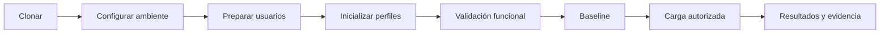
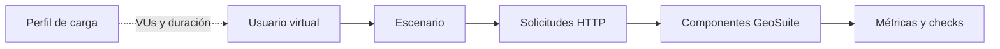

<div align="center">

# GeoSuite Performance Tests

**Pruebas reproducibles de rendimiento HTTP, OIDC y servicios geoespaciales**


</div>

---

Suite de Grafana k6 para validar autenticación, catálogo, mapas, GeoServer y
carga de archivos de GeoSuite. Los mismos flujos se reutilizan en local, Linux,
Nimbus e IDCE mediante una configuración privada por ambiente.

> [!NOTE]
> Los scripts miden solicitudes HTTP/API. No abren un navegador ni miden el
> renderizado de Nuxt, DOM, JavaScript del cliente o Web Vitals. Tampoco
> sustituyen el monitoreo interno de contenedores, base de datos, CPU, memoria,
> disco y red.

## Navegación

| Preparar | Ejecutar | Consultar |
| --- | --- | --- |
| [Requisitos](#requisitos) | [Validación funcional](#validación-funcional) | [Escenarios](#escenarios-incluidos) |
| [Instalación](#instalación-desde-cero) | [Perfiles de carga](#perfiles-de-carga) | [Resultados](#resultados-y-evidencia) |
| [Configuración](#configuración-de-un-ambiente) | [Otra instancia](#ejecución-en-otra-instancia) | [Problemas frecuentes](#solución-de-problemas) |
| [Usuarios](#preparación-de-usuarios) |  | [Documentación](#documentación-complementaria) |

### Flujo de trabajo



## Escenarios incluidos

### Modelo conceptual

Un **escenario** representa un recorrido de usuario y define qué operaciones se
ejecutan y en qué orden. Un **perfil de carga** determina cuántos usuarios
virtuales reproducen ese recorrido, durante cuánto tiempo y con qué patrón de
concurrencia. Separar ambos conceptos permite utilizar el mismo flujo primero
como validación funcional y después como baseline, carga, estrés o pico.



| Concepto | Significado en esta suite |
| --- | --- |
| **VU** | Usuario virtual concurrente. En flujos autenticados recibe una cuenta exclusiva. |
| **Iteración** | Una ejecución completa del recorrido definido por el escenario. |
| **Sesión** | Autenticación OIDC reutilizada por el mismo VU, excepto en la prueba específica de login. |
| **Check** | Validación funcional de estado, formato o contenido de una respuesta. |
| **Threshold** | Criterio global de aceptación para errores, checks, sesión o latencia. |
| **Perfil** | Patrón temporal de concurrencia: functional, baseline, load, stress, spike o recovery. |

> [!IMPORTANT]
> Un HTTP 200 no basta para aprobar. Los checks también comprueban que el JSON,
> la sesión, la imagen o la respuesta OGC correspondan al resultado esperado.

### Mapa de cobertura

| Archivo | Flujo | Autenticación | Efecto |
| --- | --- | --- | --- |
| [`00-smoke.js`](scenarios/00-smoke.js) | Disponibilidad de Nginx y API de catálogo | No | 🟢 Lectura |
| [`01-auth.js`](scenarios/01-auth.js) | NextAuth, Keycloak OIDC y perfil Django/GeoNode | Sí | 🔵 Sesión |
| [`02-catalog.js`](scenarios/02-catalog.js) | Listado, clasificación, filtros, búsqueda y detalle | Configurable | 🟢 Lectura |
| [`03-maps.js`](scenarios/03-maps.js) | Visor, mapas, capas, WMTS/MVT, WMS y WFS | Configurable | 🟢 Lectura |
| [`04-upload.js`](scenarios/04-upload.js) | Cuota, upload, análisis, preview e importación | Sí | 🟠 Condicional |

### Qué representa cada escenario

#### `00-smoke.js` — disponibilidad mínima

Es una **prueba de humo**, no una prueba de capacidad. Confirma con una sola
solicitud que el generador resuelve el dominio y que Nginx y la API responden
con JSON válido. Si falla, los escenarios posteriores no producirían datos de
rendimiento útiles porque el problema sería de disponibilidad o conectividad.

**Presiona principalmente:** Nginx y Django/GeoNode.

**Criterio conceptual:** la plataforma está alcanzable y entrega una respuesta
funcional básica.

#### `01-auth.js` — inicio de sesión completo

Representa a una persona que entra al módulo administrativo. Recorre CSRF,
redirecciones, Authorization Code con PKCE, formulario de Keycloak, callback de
NextAuth, creación de sesión y consulta del perfil protegido. Cada iteración
crea un login nuevo porque el objetivo es medir específicamente autenticación.

**Presiona principalmente:** Nginx, NextAuth, Keycloak y Django/GeoNode.

**Criterio conceptual:** la identidad se transforma en una sesión válida y en
un usuario reconocido por la aplicación.

#### `02-catalog.js` — consulta y descubrimiento

Representa a un usuario que abre el catálogo, filtra tipos de contenido, busca
por texto y consulta detalles. Descubre automáticamente recursos visibles para
evitar IDs fijos y poder ejecutarse en instancias con contenidos diferentes.
En carga autenticada, cada VU inicia sesión una vez y la reutiliza.

**Presiona principalmente:** Nginx, Nuxt, API Django/GeoNode y consultas de
PostgreSQL.

**Criterio conceptual:** el catálogo localiza recursos coherentes y mantiene
tiempos aceptables al aumentar usuarios concurrentes.

#### `03-maps.js` — visualización geoespacial

Representa la apertura de un mapa y la consulta de sus capas. Valida primero
los metadatos del mapa y después los servicios que realmente entregan la
representación geográfica: WMTS/MVT o el fallback WMS, además de WFS cuando
corresponde. Distingue una imagen válida de una excepción OGC con HTTP 200.

**Presiona principalmente:** Nginx, API de mapas, GeoNode, GeoServer y
PostGIS.

**Criterio conceptual:** una capa registrada también está publicada y puede
ser consumida por el visor.

#### `04-upload.js` — ingreso y procesamiento de datos

Representa a un usuario que carga un archivo y espera su procesamiento
asíncrono. El modo `analyze` mide recepción, análisis y preview sin conservar un
dataset; el modo `full` continúa con importación y publicación WMS/WFS. Por esa
diferencia, solo `analyze` es apropiado para concurrencia controlada.

**Presiona principalmente:** Nginx, Django/GeoNode, almacenamiento temporal,
Celery, PostgreSQL/PostGIS y, en modo `full`, GeoServer.

**Criterio conceptual:** el archivo atraviesa correctamente cada estado del
pipeline y produce el resultado esperado.

### Límites de interpretación

- Los escenarios reproducen tráfico de protocolo, no interacción gráfica de
  un navegador.
- La latencia de k6 incluye red y tiempo de respuesta HTTP, pero no renderizado
  del cliente.
- Los resultados indican lo que observa el usuario; la causa interna de una
  degradación requiere correlacionar métricas y logs de infraestructura.
- Un perfil intenso no amplía el flujo: aumenta la concurrencia sobre las
  mismas operaciones validadas funcionalmente.

Las rutas `sigic-resources` y `sigic-maps` que aparecen en el código son
identificadores técnicos de la API instalada. Se conservan para mantener
compatibilidad entre las instancias de GeoSuite.

El detalle de las solicitudes y sus precondiciones está en
[`docs/SCENARIOS.md`](docs/SCENARIOS.md).

## Estructura del repositorio

```text
geosuite-performance-tests/
├── config/      Plantilla de ambiente y ejemplo del pool de usuarios
├── data/        Archivos sintéticos, pequeños y seguros para pruebas
├── docs/        Diseño de escenarios y reglas de reproducción
├── lib/         Autenticación, sesiones y perfiles de carga
├── results/     Salidas locales de k6; no se versionan
├── scenarios/   Flujos funcionales de k6
└── scripts/     Aprovisionamiento e inicialización de usuarios
```

No se versionan el binario de k6, archivos `*.env`, pools de usuarios ni
resultados. Cada operador debe generarlos en su propia máquina.

## Requisitos

### Generador de carga

- Linux x86_64 o ARM64. WSL funciona para la validación local.
- Grafana k6; esta suite fue validada con `v2.3.0`.
- Bash, `curl`, Python 3 y OpenSSL.
- Git para identificar la versión ejecutada.
- Resolución DNS hacia el dominio de la instancia.
- Certificado TLS válido en servidores HTTPS.

Docker Desktop no es necesario: k6 se ejecuta como CLI nativo. Para pruebas de
carga formales conviene usar un equipo Linux separado del servidor evaluado,
de modo que el generador no consuma sus recursos.

> [!TIP]
> Usa el equipo local para validar los flujos y obtener una línea base pequeña.
> Reserva un generador Linux independiente para las ejecuciones formales.

### Plataforma objetivo

- GeoSuite en ejecución y accesible por su entrada Nginx.
- Realm, cliente OIDC y rutas de autenticación operativos.
- Al menos un recurso visible para catálogo.
- Para mapas, un mapa visible con una capa realmente publicada en GeoServer.
- Para upload, cuota disponible y permisos de carga.
- Cuentas exclusivas de prueba; una por VU autenticado simultáneo.

## Instalación desde cero

### 1. Clonar el repositorio

```bash
git clone https://github.com/aranzaaguirre/geosuite-performance-tests.git
cd geosuite-performance-tests
```

Registra el commit que ejecutarás:

```bash
git rev-parse HEAD
```

Esto permite relacionar cada resultado con una versión exacta de los scripts.

### 2. Preparar k6

Instala k6 para la arquitectura del generador siguiendo el mecanismo aprobado
para ese servidor. Comprueba primero si ya está disponible:

```bash
uname -m
k6 version
```

Si está instalado globalmente:

```bash
export K6_BIN="$(command -v k6)"
```

También se puede descargar el binario validado dentro de `.tools/`, directorio
ignorado por Git. En Linux x86_64 utiliza `amd64`; en ARM64 cambia el valor de
`K6_ARCH` a `arm64`:

```bash
K6_VERSION=v2.3.0
K6_ARCH=amd64

curl -fL \
  -o "/tmp/k6-${K6_VERSION}-linux-${K6_ARCH}.tar.gz" \
  "https://github.com/grafana/k6/releases/download/${K6_VERSION}/k6-${K6_VERSION}-linux-${K6_ARCH}.tar.gz"

curl -fL \
  -o "/tmp/k6-${K6_VERSION}-checksums.txt" \
  "https://github.com/grafana/k6/releases/download/${K6_VERSION}/k6-${K6_VERSION}-checksums.txt"
```

Verifica la descarga antes de extraerla:

```bash
cd /tmp
grep "k6-${K6_VERSION}-linux-${K6_ARCH}.tar.gz" \
  "k6-${K6_VERSION}-checksums.txt" \
  | sha256sum -c -
cd -
```

El resultado debe terminar en `OK`. Después:

```bash
mkdir -p .tools
tar -xzf "/tmp/k6-${K6_VERSION}-linux-${K6_ARCH}.tar.gz" \
  -C .tools

export K6_BIN="$PWD/.tools/k6-v2.3.0-linux-amd64/k6"
"$K6_BIN" version
```

Si elegiste `arm64`, ajusta también la ruta de `K6_BIN`. No copies un binario
`amd64` a un servidor `arm64`. Si `k6 version` no funciona, detente antes de
configurar o ejecutar pruebas.

## Configuración de un ambiente

### 1. Crear el archivo privado

Usa un nombre que identifique el destino (`local`, `linux`, `nimbus` o `idce`):

```bash
cp config/local.env.example config/AMBIENTE.env
chmod 600 config/AMBIENTE.env
nano config/AMBIENTE.env
```

Nunca edites `local.env.example` con secretos. El archivo nuevo está excluido
por `.gitignore`.

> [!IMPORTANT]
> Cada ambiente debe conservar su propio `.env`, pool de usuarios y carpeta de
> resultados. No copies valores locales a Nimbus o IDCE sin verificarlos.

### 2. Completar las variables

Las variables principales son:

| Grupo | Variables | Qué se debe verificar |
| --- | --- | --- |
| Destino | `TEST_ENV_NAME`, `BASE_URL` | Nombre corto y origen público sin `/` final |
| OIDC | `OIDC_ISSUER`, `KEYCLOAK_CLIENT_ID`, `KEYCLOAK_REALM` | Realm y cliente del módulo administrativo |
| Rutas | `ADMIN_BASE`, `APP_BASE`, `API_BASE`, `AUTH_*` | Rutas realmente expuestas por Nginx |
| Usuarios | `AUTH_USERNAME`, `AUTH_PASSWORD`, `AUTH_USERS_FILE` | Cuenta funcional o pool privado |
| Catálogo | `CATALOG_*`, `DISCOVERY_PAGE_SIZE` | Acceso y perfiles que se descubrirán |
| Mapas | `MAP_*`, `GEOSERVER_BASE` | Mapa, capas y servicios OGC |
| Upload | `UPLOAD_*` | Archivo, polling, limpieza y publicación |
| Carga | `TEST_PROFILE`, `PROFILE_*` | Concurrencia, duración y umbrales |

Configuración mínima orientativa para un servidor:

```env
TEST_ENV_NAME=nimbus
BASE_URL=https://dominio-real-de-geosuite

KEYCLOAK_REALM=sigic
KEYCLOAK_CLIENT_ID=sigic-admin
OIDC_ISSUER=https://dominio-real-de-geosuite/iam/realms/sigic

AUTH_USERS_FILE=../config/users.nimbus.json
TEST_PROFILE=functional
```

En local, `BASE_URL` puede usar HTTP si así está desplegada la instalación. En
Nimbus e IDCE debe usarse su URL HTTPS real. No uses
`--insecure-skip-tls-verify` para ocultar problemas de certificados.

`config/local.env.example` contiene todas las opciones y valores seguros por
defecto. No ejecutes `source .env` sobre el archivo de Docker Compose: no es el
archivo de configuración de estas pruebas y puede contener sintaxis distinta.

### 3. Cargar la configuración en la terminal

Cada terminal nueva necesita cargar el ambiente y localizar k6:

```bash
cd geosuite-performance-tests

export K6_BIN="$(command -v k6)"

set -a
source config/AMBIENTE.env
set +a
```

Si usas el binario de `.tools/`, sustituye únicamente la línea de `K6_BIN`.

Comprueba valores no sensibles:

```bash
printf 'Ambiente: %s\nBase URL: %s\nOIDC: %s\n' \
  "$TEST_ENV_NAME" "$BASE_URL" "$OIDC_ISSUER"
```

### 4. Verificar conectividad

```bash
curl -fsSI "$BASE_URL"
```

```bash
curl -fsS \
  "$BASE_URL/api/v2/sigic-resources/?page=1&page_size=1" \
  | python3 -m json.tool \
  | head -40
```

```bash
curl -fsS \
  "$OIDC_ISSUER/.well-known/openid-configuration" \
  | python3 -m json.tool \
  | head -60
```

No continúes si falla DNS, TLS, la API o el documento de descubrimiento OIDC.

## Preparación de usuarios

### Cuántas cuentas se necesitan

Cada VU autenticado recibe una cuenta distinta. El código detiene la ejecución
si el pool es menor que la concurrencia solicitada.

| Perfil | Mínimo de cuentas |
| --- | ---: |
| `functional` | 1 |
| `baseline` | `PROFILE_VUS` |
| `load` | `PROFILE_VUS` |
| `spike` | `PROFILE_VUS` |
| `recovery` | `PROFILE_VUS` |
| `stress` | `3 × PROFILE_VUS` |

Comienza con pocas cuentas en local (por ejemplo, 3 para baseline). Crea el
máximo requerido solo en un ambiente autorizado.

### Opción A: aprovisionamiento automático

El aprovisionador crea o actualiza cuentas en Keycloak, genera
`config/users.AMBIENTE.json`, aplica permisos `600` y actualiza
`AUTH_USERS_FILE` en el archivo del ambiente:

```bash
./scripts/provision-users.sh
```

El asistente solicita la ruta de `config/AMBIENTE.env`, la cantidad de cuentas
y la contraseña administrativa de Keycloak de forma oculta.

Para que funcione, configura en el archivo del ambiente:

```env
KEYCLOAK_ADMIN_MODE=local
KEYCLOAK_ADMIN_URL=https://dominio-real-de-geosuite/iam
KEYCLOAK_REALM=sigic
KC_ADMIN_USERNAME=USUARIO_ADMINISTRATIVO
KC_ADMIN_REALM=master
```

- `local`: ejecuta `kcadm.sh` desde el generador; es el modo normal contra un
  servidor remoto.
- `docker`: ejecuta `kcadm.sh` dentro del servicio de Keycloak y solo funciona
  cuando Docker Compose de la plataforma es accesible desde esa ubicación.

La contraseña administrativa no se guarda en el `.env`. Las claves `.pem` de
SSH sirven para conectarse al servidor, no sustituyen la credencial
administrativa de Keycloak.

### Opción B: pool proporcionado por el administrador

Si no tienes autorización para crear cuentas, solicita un pool exclusivo y
guárdalo siguiendo `config/users.example.json`:

```json
[
  {
    "username": "usuario-prueba-001",
    "password": "credencial-privada"
  }
]
```

```bash
chmod 600 config/users.AMBIENTE.json
```

Apunta `AUTH_USERS_FILE` a ese archivo. La ruta se resuelve desde los módulos
de k6, por eso el formato habitual es:

```env
AUTH_USERS_FILE=../config/users.AMBIENTE.json
```

### Inicializar perfiles Django/GeoNode

Una cuenta puede existir en Keycloak y todavía no tener perfil sincronizado en
Django/GeoNode. Después de crear el pool, ejecuta una vez:

```bash
"$K6_BIN" run scripts/initialize-users.js
```

El inicializador usa un solo VU y hace un login secuencial por cuenta; no es una
prueba de carga. Debe terminar con `auth_session_valid=100%`, checks al 100 % y
sin errores HTTP.

## Validación funcional

La puerta funcional comprueba una iteración antes de introducir concurrencia.
Ejecuta los escenarios en este orden:

```bash
TEST_PROFILE=functional \
  "$K6_BIN" run scenarios/00-smoke.js
```

```bash
TEST_PROFILE=functional \
  "$K6_BIN" run scenarios/01-auth.js
```

```bash
TEST_PROFILE=functional \
CATALOG_AUTHENTICATED=true \
  "$K6_BIN" run scenarios/02-catalog.js
```

```bash
TEST_PROFILE=functional \
MAP_AUTHENTICATED=true \
  "$K6_BIN" run scenarios/03-maps.js
```

```bash
TEST_PROFILE=functional \
UPLOAD_MODE=analyze \
UPLOAD_CLEANUP_JOB=true \
  "$K6_BIN" run scenarios/04-upload.js
```

Condiciones para aprobar:

- cero checks funcionales fallidos;
- `auth_session_valid=100%` en los flujos autenticados;
- sin errores inesperados de HTTP, OIDC u OGC;
- catálogo con al menos un recurso compatible;
- mapa con una capa anunciada y utilizable por GeoServer;
- upload analizado y job temporal eliminado.

`CATALOG_AUTHENTICATED=false` y `MAP_AUTHENTICATED=false` permiten validar la
entrada pública `/app`; no reemplazan la comprobación autenticada de `/admin`.

### Modo completo de upload

El modo seguro para concurrencia es `analyze`. `UPLOAD_MODE=full` importa el
dataset en GeoNode/PostGIS, comprueba WMS/WFS y puede finalizar metadatos; por
lo tanto, crea datos persistentes. El código solo permite combinarlo con el
perfil `functional`:

> [!CAUTION]
> `UPLOAD_MODE=full` modifica la plataforma. Ejecútalo únicamente con permiso,
> una sola iteración y un procedimiento definido para revisar o retirar el
> dataset creado.

```bash
TEST_PROFILE=functional \
UPLOAD_MODE=full \
UPLOAD_VERIFY_GEOSERVER=true \
UPLOAD_FINALIZE=true \
  "$K6_BIN" run scenarios/04-upload.js
```

Úsalo una vez, con autorización, y registra o retira el dataset creado.

## Perfiles de carga

`TEST_PROFILE` cambia la forma de la carga sin duplicar los flujos:

| Perfil | Ejecutor | Propósito |
| --- | --- | --- |
| `functional` | 1 VU, 1 iteración | Verificar el flujo |
| `baseline` | VUs constantes | Obtener referencia de baja carga |
| `load` | Rampa, sostenimiento y descenso | Validar la carga objetivo |
| `stress` | Tres escalones | Observar degradación y límite |
| `spike` | Incremento rápido | Simular un pico |
| `recovery` | Carga alta y reducción | Verificar recuperación |

### Baseline recomendado para comenzar

```bash
RUN_ID="baseline-catalog-$(date +%Y%m%d-%H%M%S)"
mkdir -p "results/$TEST_ENV_NAME/$RUN_ID"

TEST_PROFILE=baseline \
PROFILE_VUS=3 \
PROFILE_DURATION=2m \
  "$K6_BIN" run \
  --summary-export="results/$TEST_ENV_NAME/$RUN_ID/summary.json" \
  scenarios/02-catalog.js
```

Variables de control:

- `PROFILE_VUS`: objetivo principal de VUs;
- `PROFILE_DURATION`: duración de baseline;
- `PROFILE_STAGE_DURATION`: duración de cada rampa;
- `PROFILE_HOLD_DURATION`: tiempo sostenido;
- `PROFILE_RECOVERY_DURATION`: periodo de observación posterior;
- `PROFILE_BASE_VUS`: carga normal para spike y recovery;
- `PROFILE_P95_MS`: sobrescribe el umbral p95 del escenario.

Umbrales iniciales incluidos en el código:

- checks superiores al 99 %;
- solicitudes HTTP fallidas inferiores al 1 %;
- `auth_session_valid=100%`;
- p95 menor de 2 s para autenticación y catálogo;
- p95 menor de 3 s para mapas;
- p95 menor de 5 s para carga y análisis.

Son criterios iniciales, no un SLA. Primero obtén y revisa el baseline; luego
acuerda objetivos y condiciones de detención antes de usar `load`, `stress`,
`spike` o `recovery`. No ejecutes perfiles intensivos en producción sin
autorización y monitoreo.

> [!WARNING]
> Una prueba de estrés puede degradar o interrumpir el servicio. Confirma la
> ventana, los responsables, el monitoreo y las condiciones de aborto antes de
> comenzar.

## Resultados y evidencia

La salida de consola resume checks, latencia, errores, solicitudes, VUs y
tráfico. `--summary-export` conserva un JSON reproducible, pero no genera por sí
solo métricas internas del servidor ni un tablero histórico.

Por ejecución registra:

- commit del repositorio (`git rev-parse HEAD`);
- versión y arquitectura de k6;
- ambiente, escenario, perfil, VUs y duración;
- fecha de inicio/fin y zona horaria;
- `summary.json` y salida de consola;
- CPU y RAM del generador;
- CPU, RAM, disco, red, reinicios y logs de la plataforma;
- observaciones o errores funcionales.

Los resultados están excluidos de Git. Guárdalos en el repositorio de
evidencias autorizado. Prometheus o Grafana no son obligatorios para ejecutar
k6; intégralos solo si la instancia ya los utiliza o si se aprueba esa
necesidad de monitoreo.

## Ejecución en otra instancia

No es necesario recrear los scripts. Para mover la suite a Linux, Nimbus o
IDCE:

1. Clona el mismo commit del repositorio.
2. Instala un k6 compatible con la arquitectura.
3. Crea `config/NUEVO_AMBIENTE.env` desde la plantilla.
4. Configura las URL HTTPS, OIDC y rutas reales de esa instancia.
5. Crea o recibe un pool exclusivo de usuarios.
6. Inicializa sus perfiles Django/GeoNode.
7. Ejecuta la puerta `functional` completa.
8. Ejecuta un baseline pequeño y monitoreado.
9. Solo después promueve a perfiles de mayor carga.

Orden recomendado:

```text
local funcional → Linux controlado → Nimbus → IDCE
```

En cada ambiente se repite `functional` y `baseline`; los escenarios se
reutilizan sin editar. No copies secretos o usuarios entre instancias salvo que
la administración lo autorice.

## Solución de problemas

<details>
<summary><strong>DNS: <code>lookup ... no such host</code></strong></summary>

<br>

El generador no resuelve el dominio. Verifica DNS o `/etc/hosts` y confirma con:

```bash
getent hosts NOMBRE_DEL_HOST
```

</details>

<details>
<summary><strong>TLS: <code>wrong version number</code> al usar HTTPS</strong></summary>

<br>

El puerto está sirviendo HTTP. Corrige `BASE_URL` para local. En servidores
reales confirma que Nginx exponga HTTPS correctamente.

</details>

<details>
<summary><strong>Configuración: variable obligatoria ausente</strong></summary>

<br>

El `.env` no fue cargado en la terminal actual:

```bash
set -a
source config/AMBIENTE.env
set +a
```

</details>

<details>
<summary><strong>k6: <code>Command not found</code></strong></summary>

<br>

La variable no persiste al cerrar la terminal. Vuelve a exportarla y comprueba:

```bash
export K6_BIN="$(command -v k6)"
"$K6_BIN" version
```

</details>

<details>
<summary><strong>OIDC: sesión vacía o sin access token</strong></summary>

<br>

Ejecuta primero `01-auth.js` con una sola cuenta. Revisa credenciales, acciones
requeridas en Keycloak, `OIDC_ISSUER`, cliente y callback. No continúes con
carga hasta obtener `auth_session_valid=100%`.

</details>

<details>
<summary><strong>GeoServer: el mapa existe, pero WMS/WMTS falla</strong></summary>

<br>

Que una capa aparezca en la API no garantiza que GeoServer la publique.
Comprueba GetCapabilities y que el nombre anunciado coincida con la capa del
mapa. Una respuesta HTTP 200 que contiene una excepción OGC es un fallo.

</details>

<details>
<summary><strong>k6: <code>thresholds ... have been crossed</code></strong></summary>

<br>

La ejecución terminó, pero incumplió uno o más criterios. Revisa checks,
`http_req_failed`, p95 y recursos del generador/servidor. No aumentes los
umbrales solo para hacer pasar la prueba; documenta y analiza el resultado.

</details>

## Documentación complementaria

- [Diseño detallado de escenarios](docs/SCENARIOS.md)
- [Resumen de reproducción por ambiente](docs/REPRODUCIBILITY.md)
- [Configuración y archivos privados](config/README.md)
- [Política de seguridad](SECURITY.md)
- [Guía de contribución](CONTRIBUTING.md)
